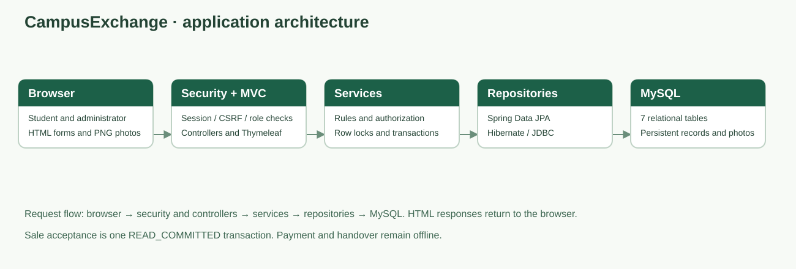
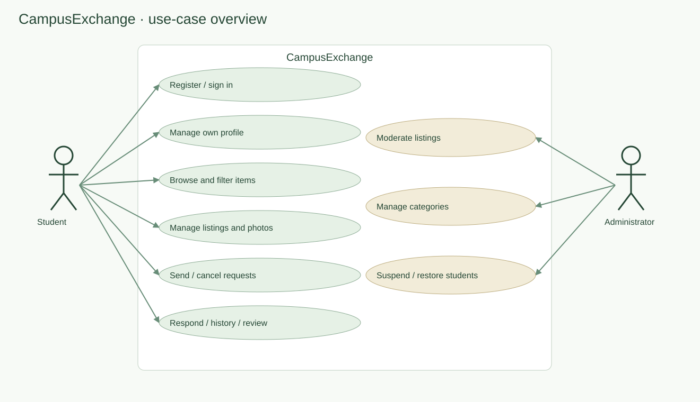
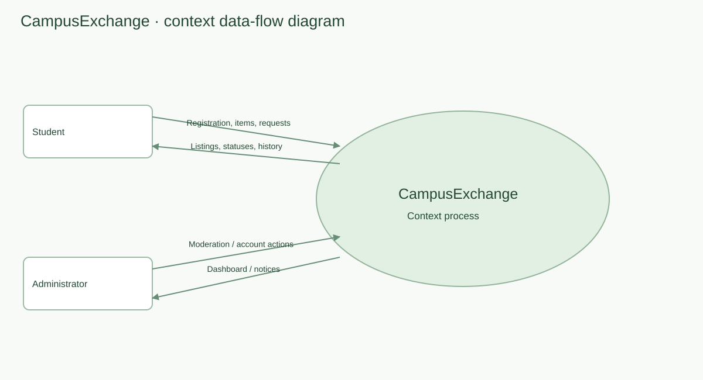
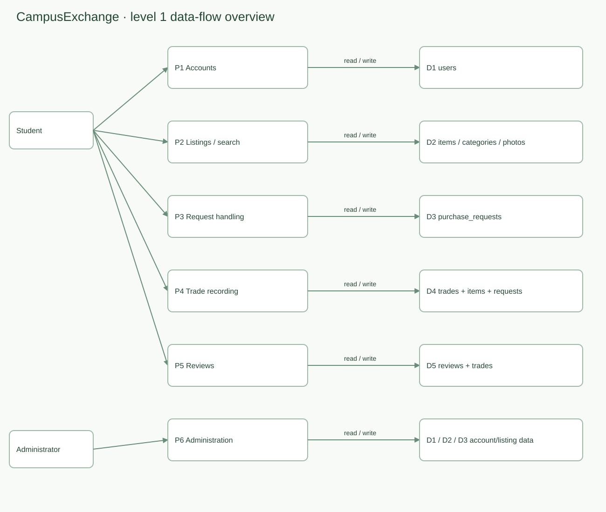
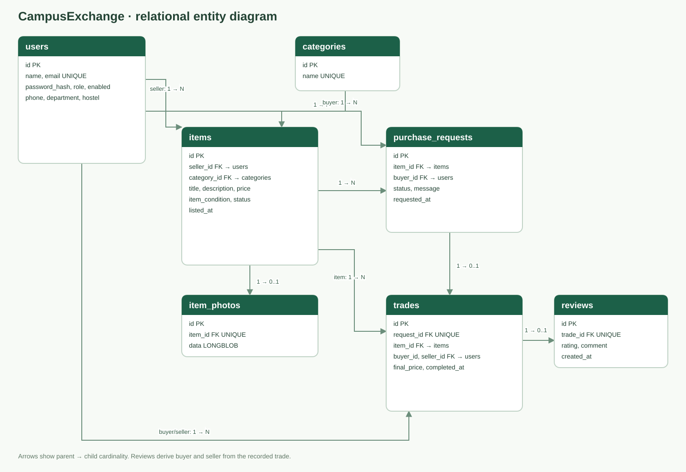
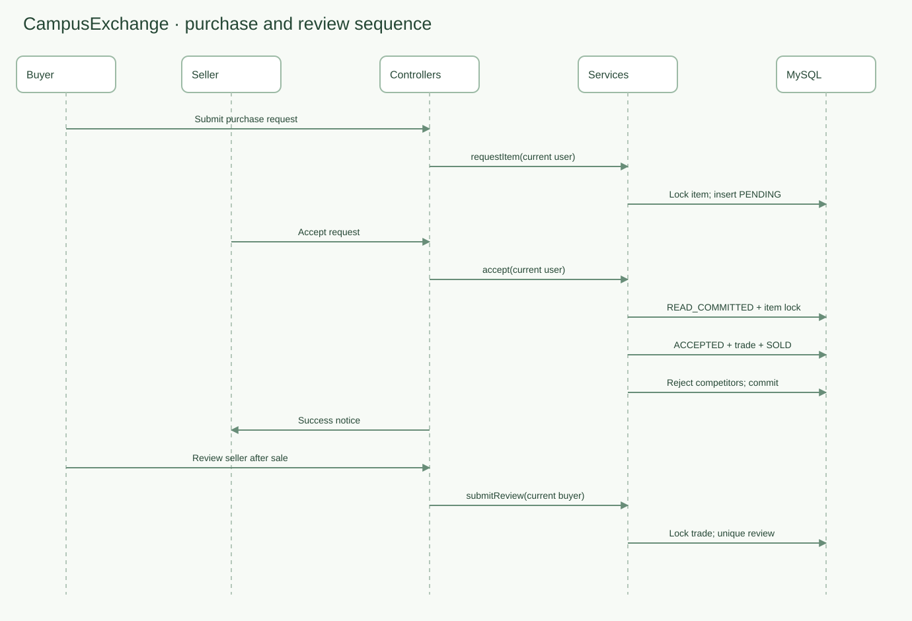
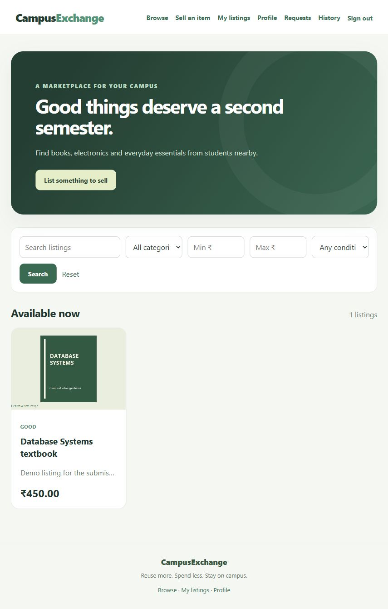
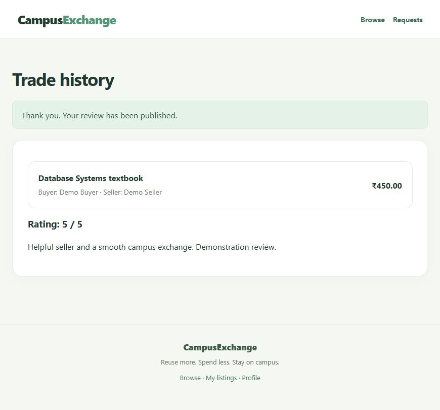
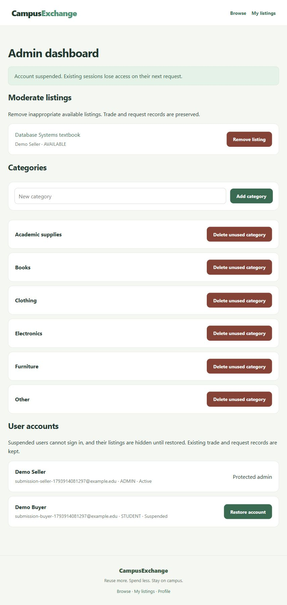

# CampusExchange

## Project report

**Project type:** Java web application with a relational database  
**Prepared:** 6 November 2026  
**Student names, roll numbers, course and instructor:** add your submission details before handing in.

## 1. Abstract

CampusExchange is a student marketplace for buying and selling pre-owned books, electronics, furniture and other campus essentials. It combines searchable listings, purchase requests, transaction history and seller ratings. Students use one account as both buyer and seller. Administrators moderate listings, manage categories and suspend or restore student accounts.

The application uses Spring Boot, Spring MVC, Thymeleaf, Spring Security, Spring Data JPA and MySQL. Its simple workflow treats seller acceptance as a completed sale. Payment and physical handover happen offline. Row locks and database transactions protect the purchase workflow; automated tests exercise concurrent requests, concurrent acceptance and duplicate reviews.

## 2. Problem definition

Campus resale activity often happens in scattered messaging groups and through word of mouth. Listings become difficult to search, sold items remain visible, and there is no consistent record of requests or completed exchanges. CampusExchange provides a structured catalogue, ownership controls, reliable sale records and a review mechanism.

The intended users are campus students and the project administrator. Registration validates email syntax and restricts registration/login to the exact @thapar.edu domain, but the application does not verify mailbox ownership or college affiliation. It should therefore be presented as a campus marketplace prototype rather than a verified student identity service.

### Objectives

- Centralize student listings and make them searchable.
- Support item creation, editing, removal and one listing photo.
- Record buyer interest through purchase requests.
- Ensure only the seller can accept or reject a request.
- Prevent a single item from being sold twice through the application workflow.
- Preserve trade history and permit one buyer review per trade.
- Support moderation and account suspension while retaining historical records.

### Scope

Included: registration, sign in, private profile editing, item listings, photos, keyword/category/price/condition search, purchase requests, cancellation, acceptance, rejection, trade history, reviews, category administration, listing moderation, and student suspension/restoration.

Excluded: online payments, shipping, real-time chat, email verification, password-reset email, reservations, and a separate handover-completion stage. Seller acceptance immediately records the sale. Reviews reflect that recorded sale; the app does not independently verify payment or physical handover.

## 3. Requirements

| ID | Functional requirement |
|---|---|
| FR01 | Register and sign in using email and a password. |
| FR02 | Edit one's own name, phone, department and hostel. |
| FR03 | Create, edit and remove one's own available listings. |
| FR04 | Upload or replace a JPEG/PNG photo for an available owned listing. |
| FR05 | Search by keyword and combine category, price and condition filters. |
| FR06 | Send a request for another student's available item. |
| FR07 | Cancel one's own pending request. |
| FR08 | Accept or reject requests for one's own listings. |
| FR09 | Record a trade on acceptance and reject competing pending requests. |
| FR10 | View one's buyer/seller trade history. |
| FR11 | Submit one 1–5 seller rating per trade, only as its recorded buyer. |
| FR12 | Moderate listings, manage unused categories and suspend/restore students as an administrator. |

Non-functional requirements include password hashing, CSRF protection, authorization at server boundaries, database integrity, persistent storage, keyboard accessibility, responsive layouts and maintainable separation between web, business and data layers. Performance has been evaluated only at small project/demo scale; the application is not load-tested for a large deployment.

## 4. Technology and architecture

| Layer | Implementation |
|---|---|
| Language/build | Java 17 target, Maven |
| Application framework | Spring Boot 3.5.16 |
| Web presentation | Spring MVC, Thymeleaf, HTML and CSS |
| Authentication/authorization | Spring Security, BCrypt, session authentication |
| Persistence | Spring Data JPA and Hibernate |
| Main database | MySQL Community Server 8.4.13 |
| Quick development/test database | H2 in MySQL compatibility mode |
| Automated tests | JUnit, Spring Boot Test, MockMvc |

Browser requests pass through Spring Security and MVC controllers. Services own business rules and transaction boundaries. Repositories execute persistence operations through JPA/Hibernate. MySQL stores users, listings, requests, trades, reviews and photo bytes. Thymeleaf renders HTML responses. Item photos are served through a controller as PNG responses.

Key packages are `controller`, `service`, `repository`, `model` and `config`. Business rules are implemented in Java service transactions; the final schema does not depend on sale-handling triggers or stored procedures.

### Use-case overview

### Data-flow overview

At level 1, the system separates into account management, listing/search management, request processing, trade recording, reviews and administration. Account management reads/writes `users`; listings read/write `items`, `categories` and `item_photos`; requests read/write `purchase_requests`; acceptance also writes `trades` and updates item/request state; review processing writes `reviews` and reads the recorded trade.

## 5. Database design

| Table | Main columns and purpose |
|---|---|
| users | id, name, unique email, password_hash, role, enabled, phone, department, hostel |
| categories | id, unique name |
| items | id, seller_id, category_id, title, description, price, item_condition, status, listed_at |
| purchase_requests | id, item_id, buyer_id, status, message, requested_at |
| trades | id, unique request_id, item_id, buyer_id, seller_id, final_price, completed_at |
| reviews | id, unique trade_id, rating, comment, created_at |
| item_photos | id, unique item_id, data as LONGBLOB |

Primary keys identify rows and foreign keys preserve relationships. User email and category name are unique. A trade refers to one accepted request; a review refers to one trade; a photo refers to one item. Price uses `DECIMAL(10,2)` to avoid binary floating-point currency errors. Java enums represent item condition, listing status, request status and account role.

The structure separates categories and user details from listing/request records. Trade rows deliberately repeat item, buyer and seller references and preserve the final price as a transaction snapshot. Because these references are derivable from the request, the implementation should not be described as strictly free of all redundant functional dependencies. It prioritizes readable history queries and immutable sale snapshots, with consistency enforced by the trade-creation service.

New installations use `database/schema.sql`. Existing installations apply migrations 002–004 in order, once each. Migrations add reviews, photos, and profile/account-status fields. The MySQL profile validates the schema at startup.

## 6. Business workflow

1. A seller creates an available item.
2. Another student submits a pending request. Self-requests and duplicate pending requests are rejected.
3. The buyer may cancel a pending request; the seller may reject it.
4. On acceptance, one transaction marks the request accepted, records a trade, marks the item sold and rejects competing pending requests.
5. The recorded buyer may review the seller once.

Editing is blocked while requests are pending so a buyer's offer does not silently change. Listing removal is a withdrawal: it hides the item and rejects pending requests while retaining records. Sold listings cannot be edited or withdrawn by the ordinary listing-management flow.

Request actions share an item row lock. `READ_COMMITTED` isolation is explicitly used for marketplace transactions so reads after a waited lock see the previous transaction's committed changes. This corrected a duplicate-request race discovered during final MySQL testing. Reviews lock their trade row and also have a unique trade foreign key.

## 7. Security and validation

Passwords are hashed with BCrypt. Registration enforces a minimum length and the BCrypt UTF-8 byte limit. Spring Security provides session authentication and CSRF checks. Controllers derive the current user from authentication, preventing a submitted account ID from changing ownership. Admin routes and admin service operations require the administrator role.

Suspension prevents authentication and invalidates existing sessions on their next authorized request. Suspended sellers' listings and photos are hidden until restoration. Their trade/request history remains stored. Admin accounts are protected from suspension through the dashboard.

Thymeleaf escapes user-supplied text. Profile fields use Bean Validation. Price/condition/type errors lead to a readable input-error page. Missing/forbidden pages have a generic error template. Image uploads are limited by bytes and dimensions, decoded as JPEG/PNG, and re-encoded as PNG before storage. Raw uploaded names are not used as filesystem paths.

## 8. Testing and results

See `TEST_RESULTS.md` for the scenario matrix and commands. The final automated suite contains workflow, security/validation and concurrency groups. The checks are run against H2 and MySQL, using a separate MySQL test schema. They are integration tests, not a claim of exhaustive penetration testing.

The concurrency checks submit operations from separate threads and verify one pending request for a simultaneous duplicate, one sale from competing acceptance, and one review from competing review submissions. MySQL persistence across database restart and the Windows PowerShell 5.1 launcher were checked earlier in this project.

A live browser walkthrough was completed on the running final app after the desktop restart. It covered registration feedback, sign in/out, listing creation and photo upload, profile saving, buyer requests, seller acceptance, trade history, reviews, admin access and suspension/restoration controls. A 390-pixel mobile viewport was visually checked. Eleven screenshots are included in screenshots/ and indexed by SCREENSHOT_GUIDE.md. Temporary demonstration records were removed after capture.

### Live application screenshots

The following captures use fictional demo accounts and an illustrative test book image.

The complete set, including mobile, profile, registration feedback, owner controls and request states, is available in SCREENSHOTS.html.

## 9. Installation and operation

The existing workspace launcher starts local MySQL and the packaged application. Open `http://localhost:8080` after startup. The standalone submission archive excludes local credentials and database files; configure MySQL using the supplied schema and environment variables when installing on another PC. Full instructions are in `USER_GUIDE.md` and the root README.

## 10. Limitations and future scope

- College affiliation and email ownership are not verified.
- Payment and handover are offline and unverified.
- The project has no password-reset email service, chat or shipping integration.
- Search and dashboards are not paginated; performance needs further work for larger datasets.
- Photos are stored in the database, increasing database/backup size.
- Current test coverage is scenario-based and does not establish production security or capacity.
- Backups, TLS deployment, monitoring and multi-instance operations need operational setup for public hosting.

Future enhancements could include email verification, account recovery, pagination, moderation audit records and image thumbnails. These are separate from the accepted simple sale workflow.

## 11. Conclusion

CampusExchange implements the core campus resale journey with persistent records, ownership checks, moderation and reviews. Final testing demonstrated why the database's real transaction behavior must be checked in addition to H2: the MySQL duplicate-request race was found and corrected before packaging. The application is suitable for a locally demonstrated academic project, with student-identification and course details to be completed before submission.

